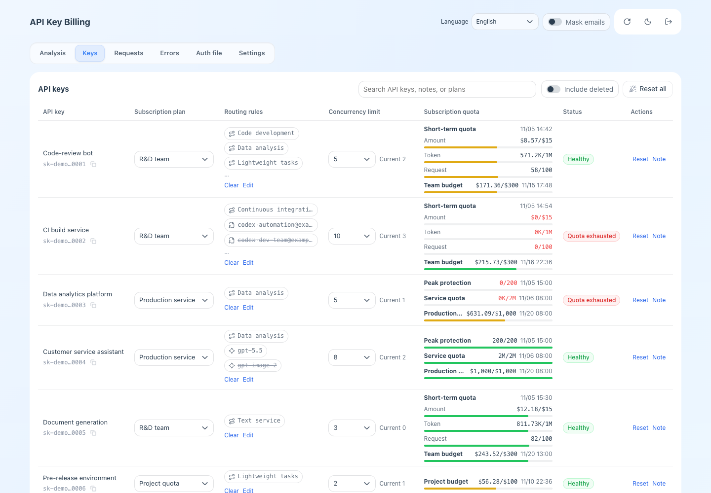
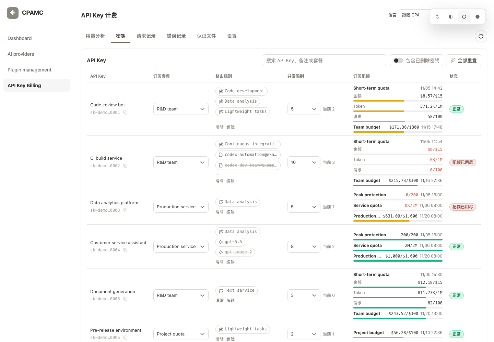
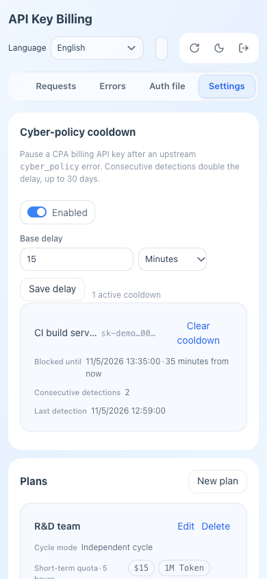
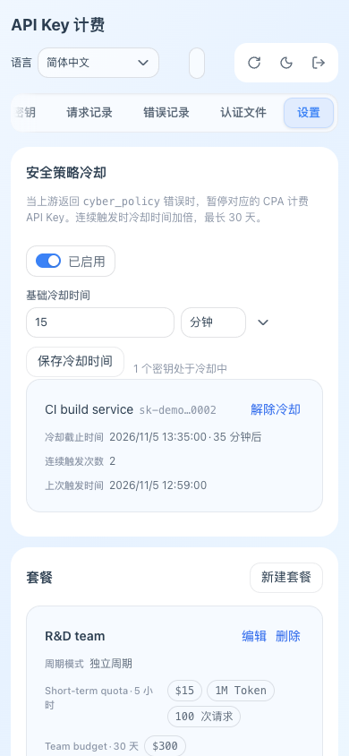
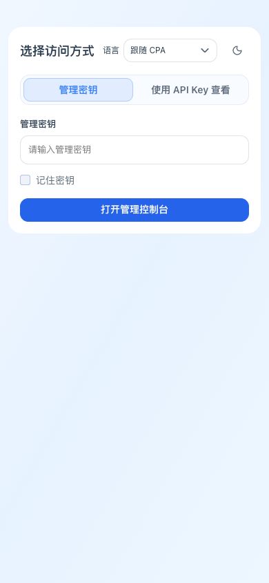

# UI language validation — 2026-11-05

This feature branch is based on `9fdb661920bea1040a58630d6bab8dbf0c1bf537`.
GitHub's compare API confirmed that upstream `main` and annotated tag `v1.4.2`
resolve to identical code. The fork is `nowanti/cpa-plugin-key-billing`.

## Result

- 20 Node tests passed, including existing formatting/navigation tests and new
  locale precedence, fallback, catalog coverage, interpolation, technical-value
  preservation, and deferred session-reload tests.
- 41 Playwright browser checks passed; no plugin JavaScript errors were observed.
  [Machine-readable results](browser-results.json).
- 8 native Linux ARM64 smoke checks passed in an isolated CPA v8.0.56 instance.
  [Machine-readable results](native-smoke.json).
- `go test -race ./...`, `go vet ./...`, `go mod tidy -diff`, `gofmt -l .`,
  `node scripts/format_ui.mjs --check`, embedded-script `node --check`, and
  `git diff --check` passed. No Go, quota, database, or routing implementation was
  changed; the billing E2E harness was not run because billing behavior did not change.

## Browser coverage

The repository's dummy backend ran on the required port `18765` with its CPAMC
shell. Playwright drove Google Chrome at 1440×1000 and 390×844. Ego Browser was
also used for live host inspection and interactive local checks. All screenshots
below contain synthetic data only.

Checks covered:

- Host HTML language changes update the embedded page in Follow CPA mode.
- Manual English overrides a Chinese host; the choice survives refresh; returning
  to Follow CPA uses the host again.
- A standalone page uses the saved same-origin CPA language and responds to
  another document's `storage` event. With no preference, it uses browser Chinese.
- A cross-origin parent safely falls back to the plugin's origin/browser language.
- All six administrator tabs load in both English and Chinese: analysis, keys,
  requests, errors, auth files, and settings. All five self-service tabs load in
  Chinese; the English self-service subscription/model view also loads.
- Plan, price, and routing validation messages are Chinese; the time picker is
  translated. Model IDs, custom names, and key notes remain unchanged, including
  a plan deliberately named `Requests` to collide with an English UI message.
- Desktop and narrow-screen language selectors remain usable, with room for the
  title and action controls. The sign-in page is usable at narrow width.
- Switching language immediately after account sign-in waits for the existing
  credential-save flow. Automatic host-driven reloads are deferred as well.

| Desktop English | Desktop Chinese |
| --- | --- |
|  |  |

| Narrow English | Narrow Chinese | Narrow sign-in |
| --- | --- | --- |
|  |  |  |

## ARM64 build and actual native load

The ARM64 build used Go `1.26.3`, CGO, and Debian 12's GCC/glibc in an ephemeral
`node:22` build container on an ARM64 Docker host. The existing image already
contained the compiler; Go was downloaded from the official distribution and
verified against the official checksum:

```text
go1.26.3.linux-arm64.tar.gz
9d89a3ea57d141c2b22d70083f2c8459ba3890f2d9e818e7e933b75614936565
```

Dependencies were vendored only into a temporary build directory; the build ran
with `--network none`. Equivalent compiler invocation:

```sh
CGO_ENABLED=1 GOOS=linux GOARCH=arm64 go build \
  -mod=vendor -buildvcs=false -trimpath -ldflags="-s -w -buildid=" \
  -tags cshared -buildmode=c-shared \
  -o dist/cpa-key-billing.so ./cmd/cpa-key-billing
```

`file` confirmed an ELF 64-bit AArch64 shared object. The highest required glibc
symbol is `GLIBC_2.34`; this build targets glibc-based Linux ARM64 and is not a
musl/Alpine library. The tested CPA v8.0.56 image uses Debian 12 / glibc 2.36.

A separate temporary CPA container used the exact current production image ID,
only a synthetic configuration, a fresh auth directory and SQLite ledger, this
new library, and a loopback-only test port. No production credential files or
volumes were mounted. Native verification checked that:

1. CPA loads the new library and serves UI bytes with exactly the source SHA-256.
2. Authenticated keys, plans, routes, Codex-routing, and cyber-policy endpoints
   return HTTP 200.
3. The isolated SQLite ledger is created.
4. The production container image identity and start time remain unchanged.

The test container was removed. The package's `BUILD_INFO.json` identifies the
source commit, UI hash, library hash, platform, and build command. The custom
binary continues to report upstream version `1.4.2`; identify this fork build by
its commit and checksum. This is a feature build, not an upstream release.

Production replacement, live customer billing requests, and an upstream PR were
outside this task and were not performed. The current production plugin remains
the upstream v1.4.2 build.
